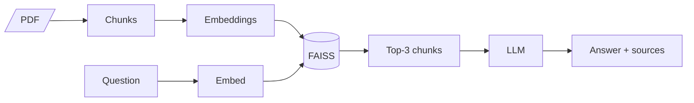

# AI Medical Chatbot with RAG

A chatbot that answers medical questions from **The Gale Encyclopedia of Medicine** PDF using
Retrieval-Augmented Generation: it finds the most relevant passages in the PDF and has an LLM
answer *only* from them, with the sources it used.

**Stack:** LangChain 0.3 · FAISS · sentence-transformers (all-MiniLM-L6-v2) · Groq Llama 3.3 (default) / Claude (backup) / HF Mistral (legacy)



## Quick start
```bash
python -m venv venv
```
```bash
.\venv\Scripts\Activate.ps1
```
```bash
pip install -r requirements.txt
```
```bash
Copy-Item .env.example .env
```
Add `GROQ_API_KEY` (and optionally `ANTHROPIC_API_KEY`) to `.env`, then:
```bash
python connect_memory_with_llm.py
```
Set `LLM_PROVIDER=claude` in `.env` to switch to Claude. Full walkthrough: [docs/SETUP.md](docs/SETUP.md).

## Files
| File | Purpose |
|---|---|
| `create_memory_for_llm.py` | Offline ingestion: PDF → chunks → embeddings → `vectorstore/db_faiss` |
| `connect_memory_with_llm.py` | Ask a question: retrieve top-3 chunks → LLM answer + sources |
| `AI medical agent RAG.drawio` | Architecture diagram (open in app.diagrams.net) |
| `data/` | Source PDF(s) |

## Docs
- [Architecture](docs/ARCHITECTURE.md): how it works, with diagrams
- [Types of RAG](docs/RAG_TYPES.md): where this project sits (Naive RAG)
- [Status vs. draw.io](docs/STATUS.md): done, partial, missing, and the gaps
- [Setup](docs/SETUP.md): step-by-step, with the reason for each step
- [Roadmap](docs/ROADMAP.md): next steps toward an industry-level project

> ⚠️ Educational project. Not medical advice.
