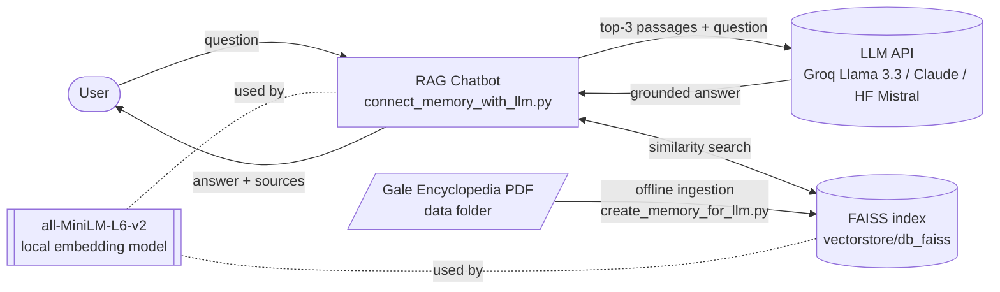
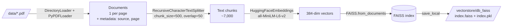
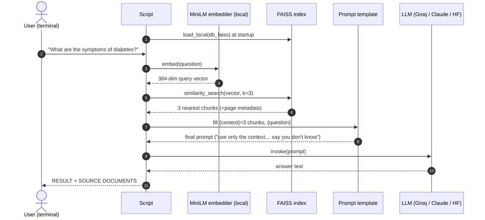
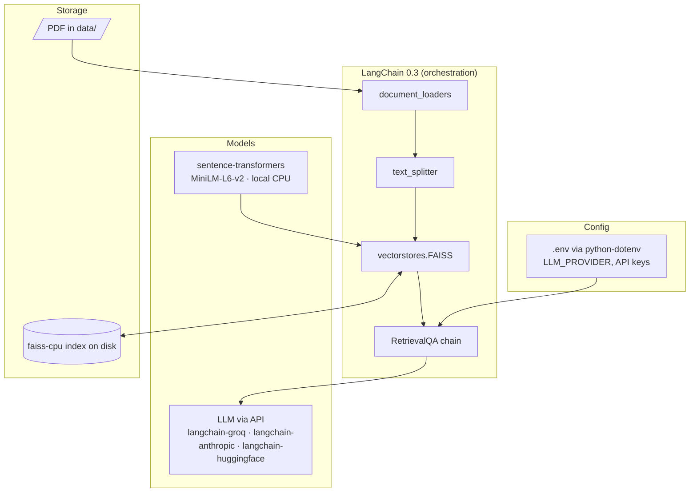

# Architecture — AI Medical Chatbot (RAG)

## 1. What this project is

A question-answering chatbot over **The Gale Encyclopedia of Medicine (2nd ed.)** PDF.
Instead of letting an LLM answer from its own memory (which can hallucinate), the app first
**retrieves** the most relevant passages from the PDF and then asks the LLM to **generate** an
answer *only* from those passages. That's **R**etrieval-**A**ugmented **G**eneration.

It's split into two scripts that match two very different moments in time:

| Script | When it runs | What it does |
|---|---|---|
| `create_memory_for_llm.py` | **Once (offline)**, or whenever PDFs change | PDF → text chunks → vectors → saved FAISS index |
| `connect_memory_with_llm.py` | **Every question (online)** | question → vector → find similar chunks → LLM answers from them |

> Analogy: the first script builds a library index card system; the second is the librarian who
> looks up the right cards and then summarises them for you.

## 2. System context

## 3. Phase 1 — Ingestion pipeline (`create_memory_for_llm.py`)

| Step | Code | Why it's done this way |
|---|---|---|
| **Load** | `DirectoryLoader(data, glob='*.pdf', loader_cls=PyPDFLoader)` | Each PDF page becomes a `Document` with `page_content` and `metadata` (`source`, `page`). Metadata is what lets you cite sources later. |
| **Chunk** | `RecursiveCharacterTextSplitter(500, 50)` | LLMs and embedding models work best on small, focused passages. "Recursive" tries to split on paragraphs → lines → sentences → words, so it rarely cuts mid-sentence. **Overlap 50** keeps a bit of shared context so a fact on a boundary isn't lost. 500 *characters* ≈ 100–120 tokens — small, which makes matches precise but can strip context (see gaps). |
| **Embed** | `sentence-transformers/all-MiniLM-L6-v2` | Turns text into a 384-number vector where *similar meaning ⇒ nearby vectors*. Runs locally on CPU, free, ~90 MB, fast. Trade-off: general-purpose, not medical-specific. |
| **Store** | `FAISS.from_documents(...).save_local(...)` | FAISS (Facebook AI Similarity Search) is an in-memory vector index library. `index.faiss` holds the vectors; `index.pkl` holds the chunk text + metadata (a pickled docstore). |

## 4. Phase 2 — Query pipeline (`connect_memory_with_llm.py`)

| Step | Code | Why |
|---|---|---|
| **Load index** | `FAISS.load_local(..., allow_dangerous_deserialization=True)` | Must use the **same embedding model** that built the index, otherwise vectors live in different "spaces". The flag is needed because `index.pkl` is a Python pickle — safe only because *you* created it. |
| **Retriever** | `db.as_retriever(search_kwargs={'k': 3})` | Returns the 3 chunks with the smallest L2 distance to the question vector. This *is* the "Ranked Results" box in the draw.io diagram — ranking = vector distance only. |
| **Prompt** | `CUSTOM_PROMPT_TEMPLATE` | Grounding instructions: answer only from context, admit "I don't know", no small talk. This is the main anti-hallucination control. |
| **Chain** | `RetrievalQA.from_chain_type(chain_type="stuff")` | "Stuff" = paste all retrieved chunks into one prompt. Simplest strategy; works because 3×500 chars is tiny. (Alternatives: map-reduce, refine — for many/large chunks.) |
| **LLM** | `load_llm(LLM_PROVIDER)` | Switchable via `.env`: **Groq** `llama-3.3-70b-versatile` (default, free, fast), **Claude** (`claude-opus-5-5`, paid backup), or the original **HF** Mistral-7B. Temperature 0.2 for Groq — factual QA should be low-randomness. |
| **Output** | `return_source_documents=True` | Prints the answer and the raw chunks used — basic transparency. |

## 5. Component / tech-stack map

## 6. Which kind of RAG is this?

**Naive RAG** (also called *vanilla* / *standard* RAG): index → retrieve → generate, in one straight line.

| Characteristic | This project |
|---|---|
| Retrieval | Dense vectors only (no keyword/BM25) |
| Query handling | Question used as-is (no rewriting, no HyDE, no decomposition) |
| Post-retrieval | None (no reranker, no compression, no relevance filtering) |
| Memory | Stateless — every question is independent |
| Control flow | Fixed, single pass (no agent, no self-check, no retry) |
| Evaluation | None |

See [RAG_TYPES.md](RAG_TYPES.md) for the full taxonomy and where to go next.

## 7. Key numbers

| Item | Value |
|---|---|
| Source | 1 PDF, 12 MB (Gale Encyclopedia of Medicine, 2nd ed.) |
| Index | `index.faiss` 10.9 MB → ≈ 7,000 vectors × 384 dims × 4 bytes |
| Chunk | 500 chars, 50 overlap |
| Top-k | 3 |
| Embedding model | all-MiniLM-L6-v2 (384-d, ~22M params) |
| LLM default | Groq `llama-3.3-70b-versatile`, max 512 output tokens |
