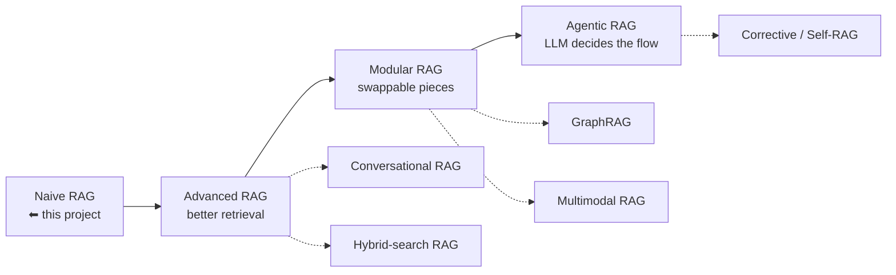
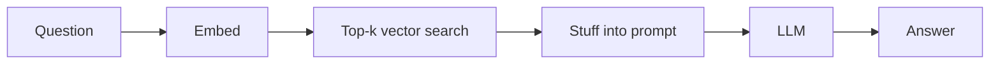
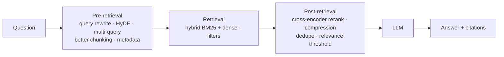
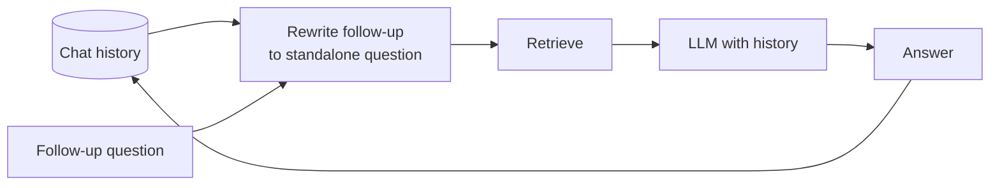
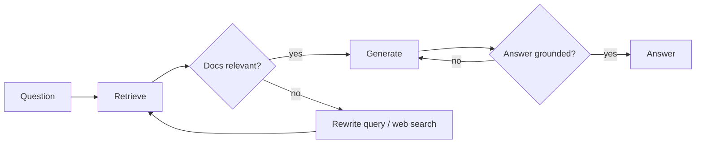
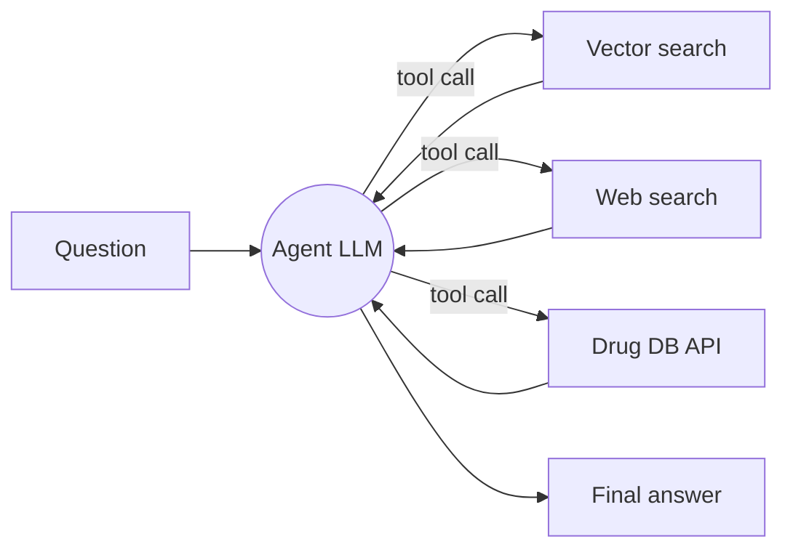

# Types of RAG — and where this project sits

RAG is not one algorithm but a **family of designs** that keep adding intelligence around the
basic loop *retrieve → augment prompt → generate*. Roughly, they evolve like this:

## 1. Naive (vanilla) RAG — ✅ *this project*
**Idea:** embed the question, take top-k similar chunks, stuff them into a prompt, generate.
**Good for:** prototypes, small clean corpora. **Weak at:** vague questions, keyword-heavy
queries (drug names, codes), multi-hop questions, follow-ups.

## 2. Advanced RAG
Adds optimisations **before**, **during** and **after** retrieval.

| Technique | What it fixes |
|---|---|
| Query rewriting / multi-query | Users ask vaguely; generate better or multiple search queries |
| HyDE | LLM writes a hypothetical answer, you search with *that* — closer to doc language |
| Semantic / token-based chunking, parent-child chunks | Small chunks for matching, bigger "parent" passage for context |
| Hybrid search (BM25 + vectors) | Vectors miss exact terms ("metformin", "ICD-10 E11") — keywords catch them |
| Cross-encoder reranker | Re-scores top-20 with a stronger model, keeps best 3–5 → much higher precision |
| Contextual compression | Strip irrelevant sentences before sending to the LLM |

## 3. Modular RAG
Treat each stage (router, retriever, reranker, generator, memory) as a **pluggable module** with
clean interfaces, so you can swap FAISS → Qdrant or Groq → Claude without rewriting. Your new
`LLM_PROVIDER` switch is a first small step in this direction.

## 4. Conversational RAG
Keeps chat history. A *history-aware retriever* first rewrites the follow-up
("what about its treatment?") into a standalone question ("treatment of diabetes") before searching.

## 5. Hybrid-search RAG
Combines sparse (BM25 keyword) and dense (embedding) retrieval and fuses the rankings
(e.g. Reciprocal Rank Fusion). Usually the single biggest retrieval quality win for technical/medical text.

## 6. Corrective RAG (CRAG) & Self-RAG
The system **checks its own work**.
- **CRAG:** grade retrieved docs; if they're irrelevant → rewrite query / fall back to web search.
- **Self-RAG:** the model decides whether to retrieve at all and critiques whether its answer is supported.

## 7. Adaptive RAG
A router classifies the question: *no retrieval needed* / *single-step RAG* / *multi-step RAG*,
and picks the cheapest path that works.

## 8. Agentic RAG
An LLM **agent** treats retrieval as a *tool* — it can call several retrievers, a web search,
a calculator or an API, loop, and decide when it has enough. Usually built with **LangGraph** or
the Claude API tool-use loop. Most flexible, highest cost/latency, hardest to test.

## 9. GraphRAG
Extracts entities and relationships (disease → symptom → drug) into a **knowledge graph** and
retrieves by traversing it. Great for multi-hop and "summarise the whole corpus" questions.

## 10. Multimodal RAG
Indexes images, tables and charts as well as text (e.g. anatomy diagrams, dosage tables in PDFs)
using vision-capable models.

---

## Where this project sits & the natural path

| Level | Status |
|---|---|
| Naive RAG | ✅ done |
| Advanced RAG (hybrid, rerank, better chunks, citations) | ⬜ next — biggest quality gain per hour |
| Conversational RAG | ⬜ comes with the Streamlit chat UI |
| Evaluation | ⬜ needed before you can claim any improvement |
| Corrective / Agentic RAG (LangGraph) | ⬜ "industry-level" stage |
| GraphRAG / Multimodal | ⬜ optional specialisations |
