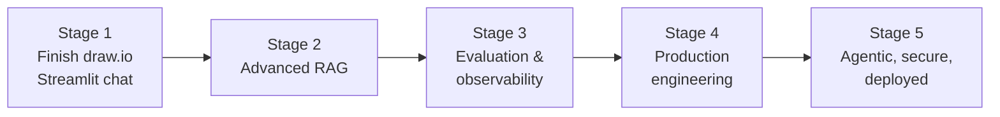

# Roadmap — from learning project to industry-grade RAG

Each stage builds on the previous one and teaches a distinct skill. Do one feature per git
branch / PR and record the evaluation score in the PR description once Stage 3 exists.



## Stage 1 — Finish the drawn architecture (Phase 3)
*Skill: building a usable LLM app.*
- `medibot.py` Streamlit chat (`st.chat_input`, `st.chat_message`, `st.session_state` history).
- Cache the vector store & LLM (`@st.cache_resource`) so they load once.
- Clean citations: "Source: Gale Encyclopedia, p. 412" instead of raw `Document` objects.
- Sidebar: provider switch (Groq ↔ Claude), top-k slider.
- Medical disclaimer banner.
- Refactor shared code into functions (`load_vectorstore()`, `build_chain()`), add a `main()`.
- Replace deprecated `RetrievalQA` with `create_retrieval_chain` / LCEL.

## Stage 2 — Advanced RAG
*Skill: retrieval quality.*
- Chunking: token-based, larger (800–1000 tokens) with overlap, or parent-child chunks; clean headers/footers.
- Hybrid search: BM25 + FAISS via `EnsembleRetriever` (Reciprocal Rank Fusion).
- Reranker: retrieve top-20, rerank with a cross-encoder (`BAAI/bge-reranker-base`) → keep 4. This makes the diagram's "Ranked Results" real.
- Better embeddings: try `BAAI/bge-small-en-v1.5` or a biomedical model; compare with eval.
- Query rewriting / multi-query; conversational (history-aware) retriever for follow-ups.
- Streaming token output in the UI.

## Stage 3 — Measure everything
*Skill: evals — what separates demos from products.*
- Golden dataset: 50–100 Q/A pairs with expected source pages (hand-written + LLM-generated, human-checked).
- Metrics with **RAGAS** or an LLM-as-judge: faithfulness, answer relevancy, context precision/recall; plus latency and cost per query.
- Retrieval metrics: hit-rate@k, MRR.
- Tracing: LangSmith or Langfuse to inspect every prompt/retrieval.
- A `make eval` / `python -m eval.run` command; run it in CI on every PR.

## Stage 4 — Production engineering
*Skill: software architecture & ops.*
```
app/
  config.py        # pydantic-settings (env-driven)
  ingest/          # loaders, cleaners, chunkers, indexing job
  retrieval/       # retrievers, reranker
  llm/             # provider factory (groq/claude), prompts
  api/             # FastAPI: POST /chat (streaming), POST /documents, GET /health
  ui/              # Streamlit or React frontend
tests/
eval/
```
- Persistent vector DB: **Qdrant** / pgvector / Chroma (replaces pickled FAISS; supports filters, updates, multi-collection).
- Document upload + background ingestion (dedupe by hash, incremental indexing).
- Docker + docker-compose (api, ui, vectordb); GitHub Actions: lint (ruff), type-check, tests, eval.
- Structured logging, error handling, retries/timeouts, rate limiting, response caching.
- Move data & index out of git (DVC, object storage, or regenerate in CI).

## Stage 5 — Industry-level capabilities
*Skill: agents, safety, deployment.*
- **Corrective / Agentic RAG with LangGraph:** route → retrieve → grade docs → (rewrite | web search fallback) → generate → check groundedness.
- Multi-document, multi-tenant: auth (JWT/OAuth), per-user collections, metadata filters.
- Guardrails: PII redaction, prompt-injection defence, medical safety policy (emergencies → "seek care", no dosing advice), output validation.
- Cost/latency dashboards, user feedback (👍/👎) feeding back into the eval set.
- Deploy: Render / Fly.io / AWS (ECS) / GCP Cloud Run; secrets manager; HTTPS.
- Optional: GraphRAG (disease–symptom–drug graph), multimodal (tables/figures), fine-tuned embeddings.

## Portfolio tips
- A great README with an architecture diagram, demo GIF, and eval results table (before/after each stage).
- Write short ADRs ("why Qdrant over FAISS") — interviewers love seeing trade-off reasoning.
- Small, frequent commits with meaningful messages.
