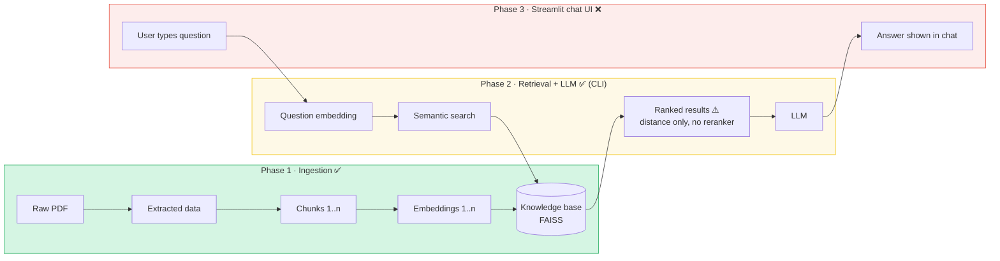

# Project status vs. the draw.io architecture

Source of truth: `AI medical agent RAG.drawio` ("Technical Architecture", 3 phases).
Open it at <https://app.diagrams.net> → *Open from device*.

## Phase checklist

| Phase | Diagram element | Status | Where in code |
|---|---|---|---|
| 1 | Raw PDF files | ✅ | `data/The_GALE_ENCYCLOPEDIA_of_MEDICINE_SECOND.pdf` |
| 1 | Knowledge source (extracted data) | ✅ | `load_pdf_files()` — `create_memory_for_llm.py` |
| 1 | Chunks of text | ✅ | `create_chunks()` (500 / 50) |
| 1 | Embeddings (HuggingFace logo) | ✅ | `get_embedding_model()` — MiniLM-L6-v2 |
| 1 | Knowledge base / Vector store FAISS | ✅ | `vectorstore/db_faiss/` (committed) |
| 2 | Question embedding | ✅ | done implicitly by the FAISS retriever |
| 2 | Semantic search | ✅ | `db.as_retriever(k=3)` |
| 2 | Ranked results (rank icon) | ⚠️ partial | ranking = raw vector distance; no reranker |
| 2 | LLM (LangChain logo) | ✅ | `load_llm()` — now Groq / Claude / HF switch |
| 3 | Streamlit UI (Streamlit logo, "what is neural network → Answer") | ❌ missing | no `medibot.py` / UI file exists |

**Overall:** about **65–70%** of the drawn architecture. The backend RAG loop works as a
one-shot terminal script; the user-facing chat app (Phase 3) was never started.

## Gaps

### Functional
- ❌ No UI — terminal only, **one question per run**, no chat history / follow-ups.
- ⚠️ Sources are printed as raw `Document(...)` objects instead of clean citations ("p. 412").
- ⚠️ The original HF Mistral endpoint likely no longer works (HF serverless → Inference Providers). Fixed by adding Groq/Claude.

### Retrieval quality (naive RAG limits)
- Dense-only search → misses exact keywords (drug names, abbreviations).
- k=3 with no reranker → relevant chunk at rank 5 is never seen.
- 500-character chunks → definitions get cut off from their headings/context.
- No query rewriting → vague questions retrieve poorly.
- PDF page headers/footers and hyphenation aren't cleaned.

### Quality assurance
- No evaluation set or metrics (faithfulness, answer relevancy, context precision) — you can't tell whether a change helped.
- No tracing/observability (LangSmith, Langfuse).

### Engineering
- Scripts run everything at import time (no functions/`main`), hard-coded paths and params.
- No logging, error handling, tests, type hints, or CI.
- No API layer (FastAPI) → can't be used by a frontend or other services.
- No Docker / deployment config.
- PDF (12 MB) and FAISS index (15 MB) committed to git; pickle loading is unsafe for untrusted files.
- `RetrievalQA` is deprecated (works on pinned LangChain 0.3; breaks on 1.x).
- Single initial commit → no history of progress.

### Domain (medical)
- No medical disclaimer / safety policy, no refusal for emergencies or dosage advice.
- No guardrails against prompt injection or off-topic use.
- Source is a 2nd-edition encyclopedia — dated medical info; no freshness strategy.
